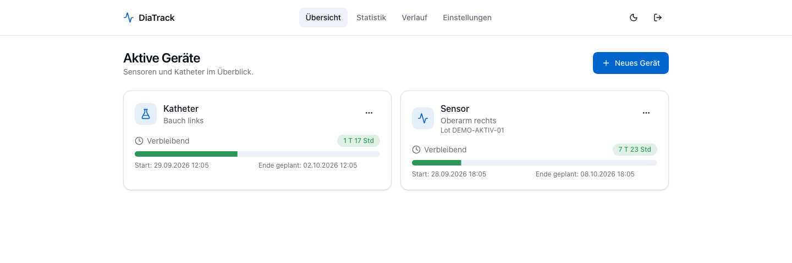
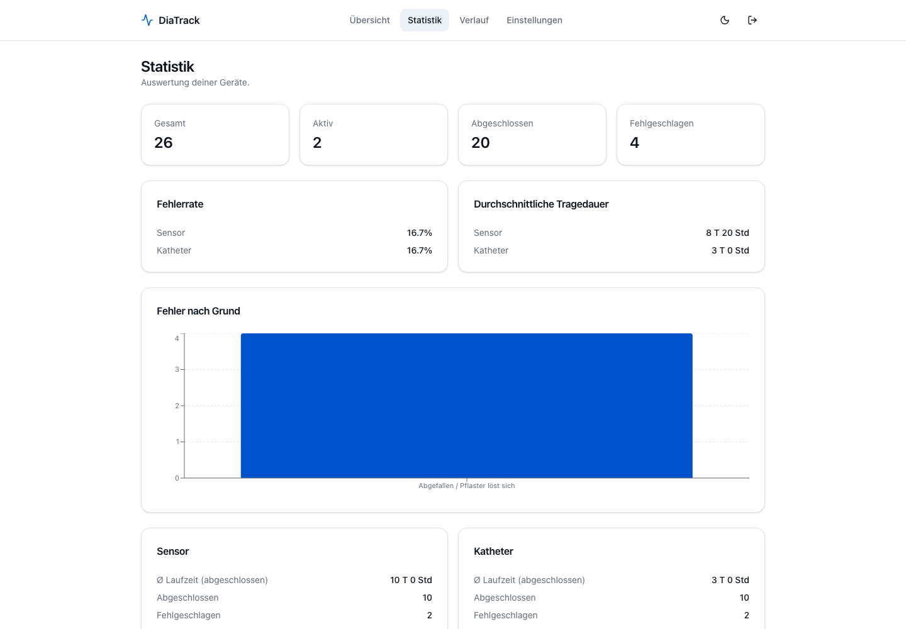

# DiaTrack

A self-hosted application for tracking diabetes sensors and catheters: when
they were installed, how long they have left, where they were placed, and why
a device ended early. Includes replacement reminders, history, and statistics.

One TypeScript application on Bun, TanStack Start, and PostgreSQL. German UI.



Screenshots show the real application running locally with synthetic device
records. They contain no personal health history.

<details>
<summary>Device history statistics</summary>



</details>

[Features](#what-it-does) · [Local setup](#local-development) ·
[Licensing](#licensing)

## Why I built this

Living with diabetes means constantly swapping sensors and catheters. It's easy to lose track of when you put one on, where it went, and when it expires. DiaTrack shows how much time is left on each device, emails reminders before they expire, and keeps a full history so patterns become visible (which locations fail early, which batches are unreliable).

## What it does

- Countdown timers for active sensors and catheters with body-location tracking
- Email reminders before a device expires (configurable, e.g. 24h and 6h before)
- Failure logging (clogged, fell off, sensor error, skin reaction)
- Statistics and charts: failure rates, average lifetimes, breakdowns by location and reason
- Full searchable, sortable history
- Per-user settings for default lifetimes and reminder intervals
- Mobile-friendly, dark mode, German UI

## Tech stack

One TypeScript app: TanStack Start (Router, Query, Form) on Vite, oRPC for the type-safe API, better-auth for sessions, Drizzle ORM on PostgreSQL, Valibot for validation, Tailwind CSS v4 with shadcn/ui, Biome and Vitest. Runtime is Bun.

## Licensing

No software license is currently specified. Public source availability alone
does not grant permission to use or redistribute the code. This presentation
update does not introduce or change licensing terms.

## Local development

You need [Bun](https://bun.sh/) and a PostgreSQL database.

```bash
git clone https://github.com/paul1404/diatrack.git
cd diatrack
bun install
cp .env.example .env
```

Edit `.env`: set `DATABASE_URL` to your Postgres instance and `BETTER_AUTH_SECRET` to a strong random string (`openssl rand -base64 32`). To create the first account through the UI, set `ALLOW_REGISTRATION=true`.

Apply the schema and start the dev server:

```bash
bun run db:migrate     # apply migrations (drizzle-kit)
bun run dev            # http://localhost:3000
```

Register an account, then promote it to admin (needed for SMTP settings and email logs):

```bash
ADMIN_EMAIL=you@example.com bun run db:seed
```

After creating your account you can set `ALLOW_REGISTRATION=false`.

### Useful scripts

| Script | What it does |
|--------|--------------|
| `bun run dev` | Start the dev server |
| `bun run build` | Production build to `dist/` |
| `bun run start` | Run the production server (`server.js`) |
| `bun run db:generate` | Generate a migration from schema changes |
| `bun run db:migrate` | Apply migrations (dev) |
| `bun run db:migrate:prod` | Apply migrations at runtime (no drizzle-kit) |
| `bun run db:seed` | Promote `ADMIN_EMAIL` to admin |
| `bun run lint` / `bun run format` | Biome |
| `bun run test` | Vitest |
| `bun run generate:icons` | Regenerate the favicon set from `public/favicon.svg` |

## Deployment (Vertex)

GitHub Actions publishes the scanned production image to GHCR after main CI
passes. The private `vertex-fleet` repository promotes its digest to the Vertex
RKE2 cluster. PostgreSQL uses Longhorn storage; a Kubernetes init container runs
`bun run db:migrate:prod` before the application starts. `/api/health` provides
the readiness and liveness check. Traefik terminates HTTPS for
`diatrack.pdcd.net`.

Required environment variables (see `.env.example`):

- `DATABASE_URL`: PostgreSQL connection string
- `BETTER_AUTH_SECRET`: strong random string, retained across deployments
- `BETTER_AUTH_URL`: public application URL
- `ALLOW_REGISTRATION`: `true` only while creating accounts

The application listens on `PORT`, set to `3000` on Vertex.
